# WRO 2026 Future Engineers - Team Glitch
 
<div align="center">
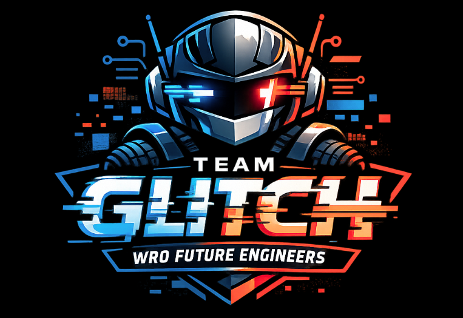
  
[](https://www.youtube.com/@TeamGlitchWRO)

</div>

---

## 🏆 WRO 2026 Future Engineers India Winners

Welcome to the GitHub repository of **Team Glitch**, competing in the **World Robot Olympiad™ (WRO) Future Engineers 2026** category at the International Finals. We are a team of 3 students who designed, built, and programmed a fully autonomous self-driving vehicle to tackle the dynamic challenges of the WRO 2026 competition.

Our name, **Glitch**, reflects our engineering philosophy - finding the unexpected edge cases, the subtle bugs, and the tiny misalignments that make the difference between successful run and an unsuccessful one. We don't just build a robot, we debug it relentlessly until every glitch is gone.

> *"Every test run is a debugging session. Every crash is data."*

**Current best timings:**
- **Open Challenge**: ~25 seconds (full score)
- **Obstacle Challenge**: ~50 seconds (full score)

---

## 📚 Table of Contents

- [📂 Documentation Structure](#-documentation-structure)
- [👥 The Team](#-the-team)
- [🎯 Challenge Overview](#-challenge-overview)
- [🤖 Our Robot](#-our-robot)
- [🔧 Electronic Systems & Components](#-electronic-systems--components)
- [⚙️ Mechanical Systems](#️-mechanical-systems)
- [💻 Software Architecture](#-software-architecture)
- [🧭 Open Challenge - Strategy & Logic](#-open-challenge--strategy--logic)
- [🚧 Obstacle Challenge - Strategy & Logic](#-obstacle-challenge--strategy--logic)
- [🏆 Our Experience at India Nationals](#-our-experience-at-india-nationals)
- [🔄 Engineering Decisions & Iterations](#-engineering-decisions--iterations)
- [📹 Performance Videos](#-performance-videos)
- [🌐 GitHub Utilization](#-github-utilization)
- [📜 License](#-license)
- [🗓️ GitHub Commit Dates](#github-commit-dates)

---

## 📂 Documentation Structure

Each folder in this repository contains detailed technical content:

| Folder | Content | 
|--------|---------|
| `v-photos/` | Robot photos - 6 angles, isometric, and labelled component view |
| `t-photos/` | Team photos - official, fun, Nationals stage |
| `schemes/` | Wiring diagrams, calculations and power architecture |
| `models/` | STL & STEP CAD files for 3D printing and poly cuts, DXF & CAD Drawings for dimension specifications |
| `src/` | Main Python scripts - obstacle, open and vision pipeline + subsystem scripts |
| `versionTest/` | Test Python scripts - All modules testing + PID gains file |
| `other/` | Component images, diagrams used in this README |
| `document/` | Engineering document PDF |
| `service-files/` | Service scripts to run open/obstacle on boot |
---

## 👥 The Team

<div align="center">

<table>
  <tr>
    <td align="center">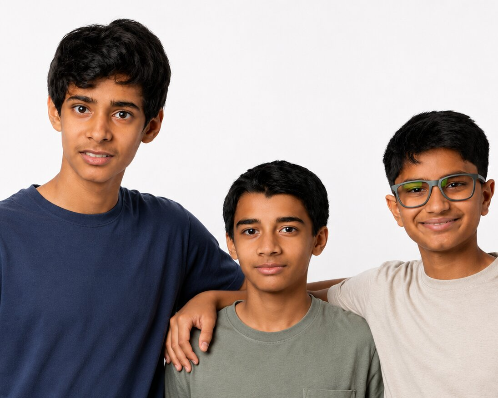</td>
    <td align="center">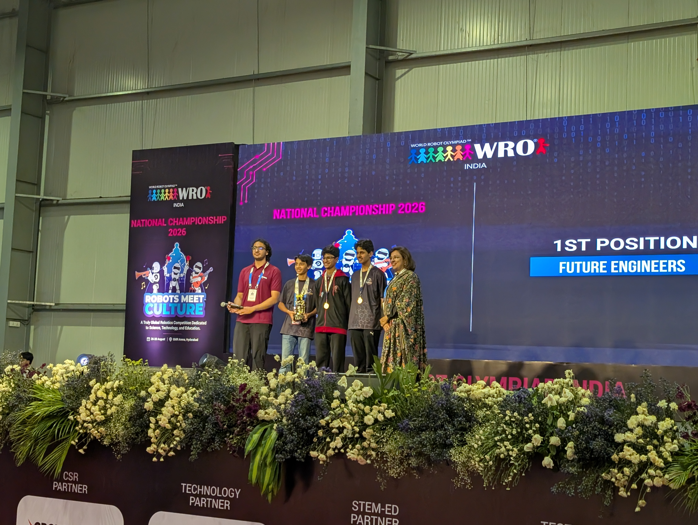</td>
  </tr>
</table>
</div>

---

| Member | Role | Background | About |
|--------|------|------------|--------|
| **Shaurya Sule** | Documentation, Electronics, Strategy | 9th Grade | Shaurya is a Grade 9 student at Dhirubhai Ambani International School with a strong interest in robotics and debate. He has participated in WRO multiple times, including competing at the World Championships and achieving 3rd place. He is also the captain of his FTC team, where he develops leadership, engineering, and problem solving skills. Alongside robotics, he is an accomplished debater and has won multiple debate championships across India.|
| **Rehaan Dhandhia** | Software, Vision & Sensor Integration | 9th Grade | Rehaan is a Grade 9 student at Dhirubhai Ambani International School. He has participated in WRO for four years and achieved 3rd place at the WRO World Finals in 2023. He has also been involved in FIRST Tech Challenge (FTC) for the past two years. Through robotics, he has developed skills in programming, electronics, and problem solving. Outside robotics, he enjoys mathematics and physics, has played the piano for eight years, and has competed in state level badminton tournaments.|
| **Zeus Wadia** | Electronics, Testing, Mechanical Design | 9th Grade | Zeus is a Grade 9 student at Dhirubhai Ambani International School, Mumbai, with a strong interest in robotics and engineering. He has competed in WRO and FTC, gaining experience in robot design, electronics, programming, and autonomous systems. In 2025, he placed 12th at the WRO Future Innovators Junior National Finals and has participated in FTC for the past two years.|

**Coach:** **Ajinkya Giri** - Robotics Engineer and Mentor

**Fun Team Photo:**
This photo is from the 2025 WRO India nationals, where the 3 of us competed as a team in the Future Innovators category and eventually placed 12th.
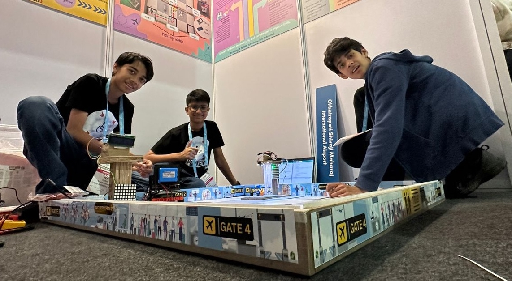

### Team Journey

Throughout development - from first chassis cut to nationals - we logged every run, debugged every crash, and iterated on every subsystem. We have also kept an Excel sheet log of every run we have made since the robot was working.

**Testing session photo:** Checking mechanical stability (tipping test).

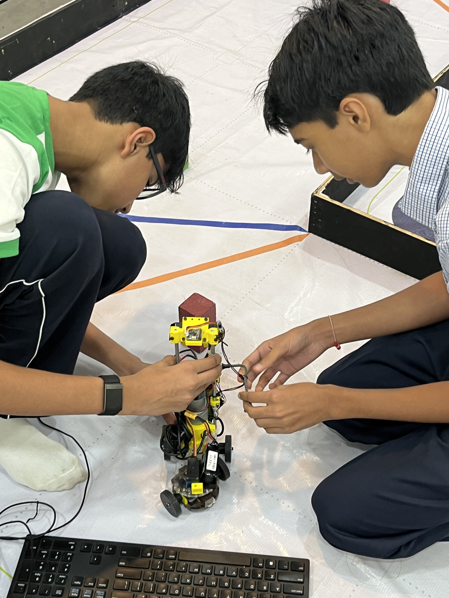

---

## 🎯 Challenge Overview

WRO 2026 Future Engineers is a self-driving car challenge on a 3m × 3m racetrack that changes configuration every round.

### Open Challenge

| Aspect | Requirement | Our Approach |
|--------|-------------|--------------|
| **Track Variability** | Random internal wall placements | Outer wall centroid PD - adapts to any corridor width |
| **Navigation** | Unknown layout each round | Camera wall detection + IMU heading hold (no hard coding) |
| **Lap Count** | 3 laps, stop in start section | Counter + `last_wall` camera zone + IMU heading snap |
| **Speed** | Sub-60s target | 85% PWM, smoothed acceleration without speed PID |

### Obstacle Challenge

| Aspect | Requirement | Our Approach |
|--------|-------------|--------------|
| **Traffic Signs** | Red - right turn, Green - left turn | OpenCV HSV centroid PD, 2-state avoidance |
| **Lap Count** | 3 laps | Floor line colour trigger with fallback timer |
| **Parking** | Fully inside lot, parallel to wall | 4-state parking state machine with camera confirmation |
| **Direction** | Detected at start | Uses camera to check which side is the black wall |

### Documentation Scoring (30 Points)

| Area | Max Points | Our Coverage |
|------|------:|------|
| **1. Mobility & Mechanical Design** | 6 | Motor selection, Parallel steering system, custom polycarbonate chassis, drive system, encoder integration |
| **2. Power & Sensor Architecture** | 6 | Dual rail power system, BNO085 IMU, sensor placement, wiring diagrams |
| **3. Software Architecture & Obstacle Strategy** | 6 | State machines, HSV vision pipeline, centroid based PD control, obstacle avoidance logic, parking sequence, source code |
| **4. Systems Thinking & Engineering Decisions** | 6 | Design iterations, subsystem integration, engineering tradeoffs, decision rationale, risk mitigation |
| **5. Reproducibility & GitHub Quality** | 6 | Structured repository, commit history, README, CAD files, wiring diagrams, full documentation, replication guide |
| **Total** | **30** | We scored 24 in Nationals |

### Educational Objectives

- **Computer Vision**: Real-world HSV colour segmentation, zone-based detection, LAB colour space
- **Control Systems**: PID steering, closed-loop speed control, positional vs. incremental PID
- **Embedded Systems**: Multiprocessing on Linux, UART communication, I2C sensor management
- **Systems Engineering**: Process isolation, shared memory, fault recovery
- **Engineering Documentation**: Decision rationale, iteration history, replication guides

---

## 🤖 Our Robot

<div align="center">

<table>
  <tr>
    <td align="center"><b>Front View</b></td>
    <td align="center"><b>Rear View</b></td>
  </tr>
  <tr>
    <td>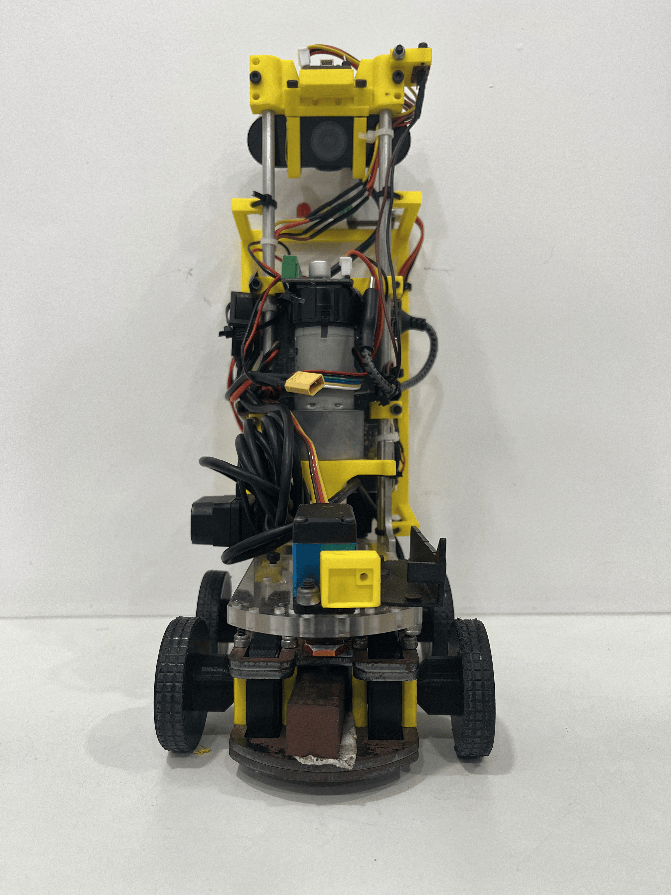</td>
    <td>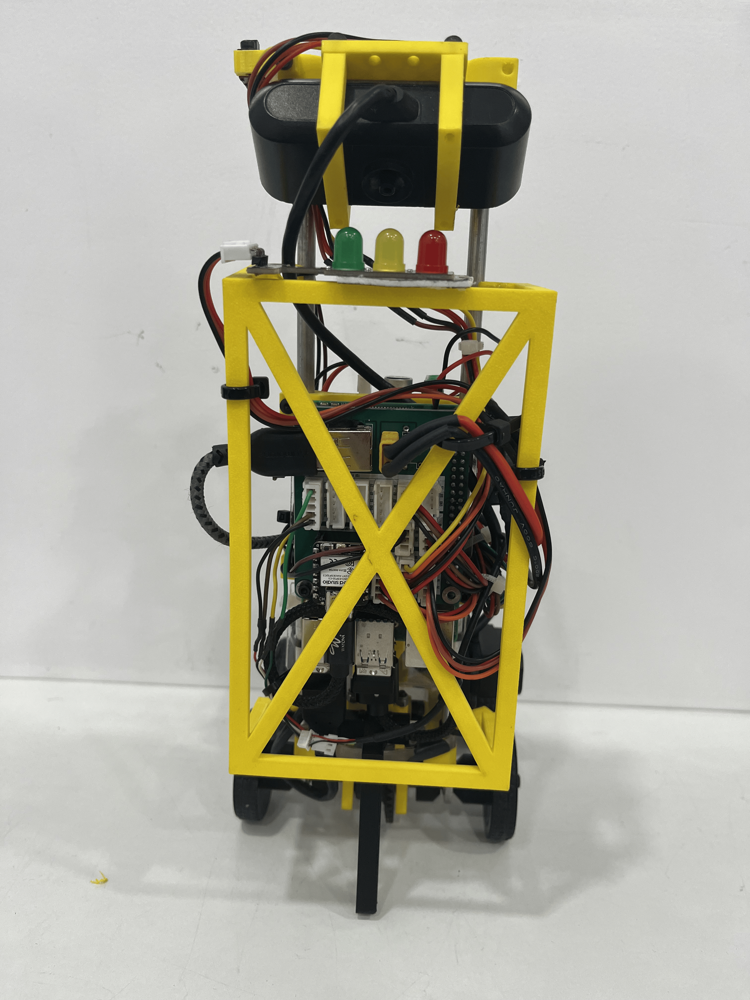</td>
  </tr>
  <tr>
    <td align="center"><b>Left Side</b></td>
    <td align="center"><b>Right Side</b></td>
  </tr>
  <tr>
    <td>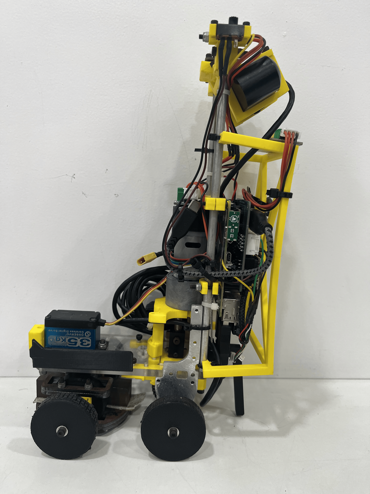</td>
    <td>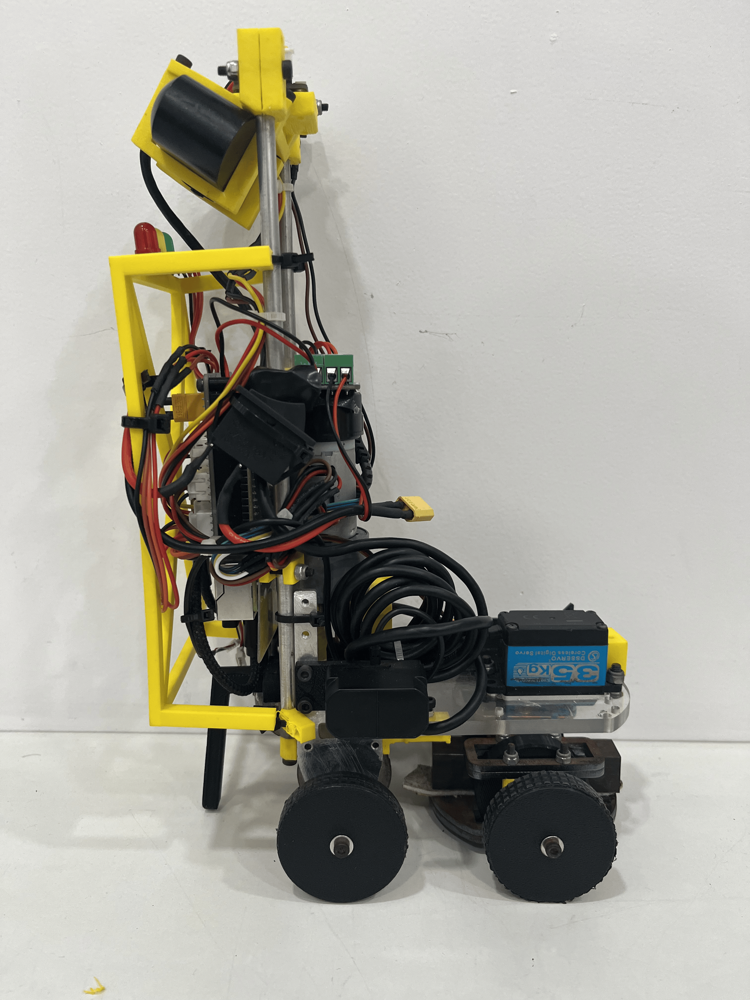</td>
  </tr>
  <tr>
    <td align="center"><b>Top View</b></td>
    <td align="center"><b>Bottom View</b></td>
  </tr>
  <tr>
    <td>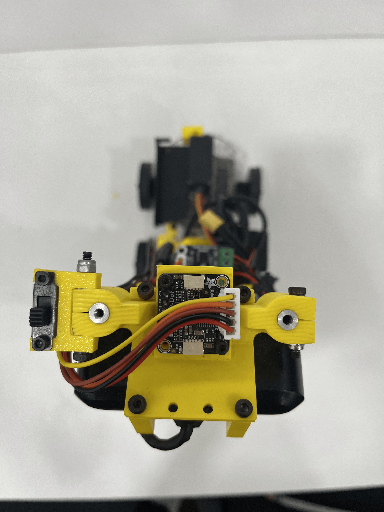</td>
    <td>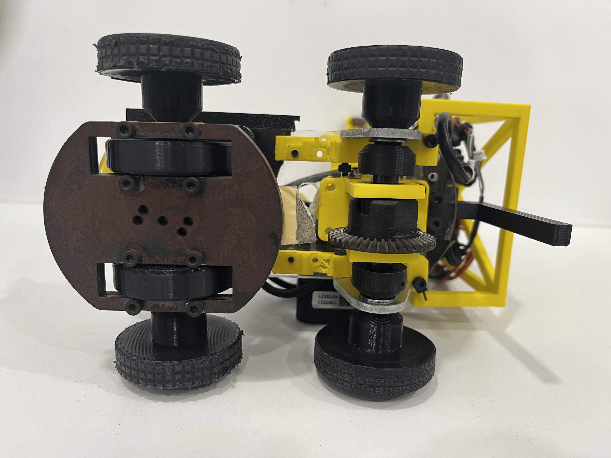</td>
  </tr>
  <tr>
    <td colspan="2" align="center"><b>Labelled Electronics View</b></td>
  </tr>
  <tr>
    <td colspan="2" align="center">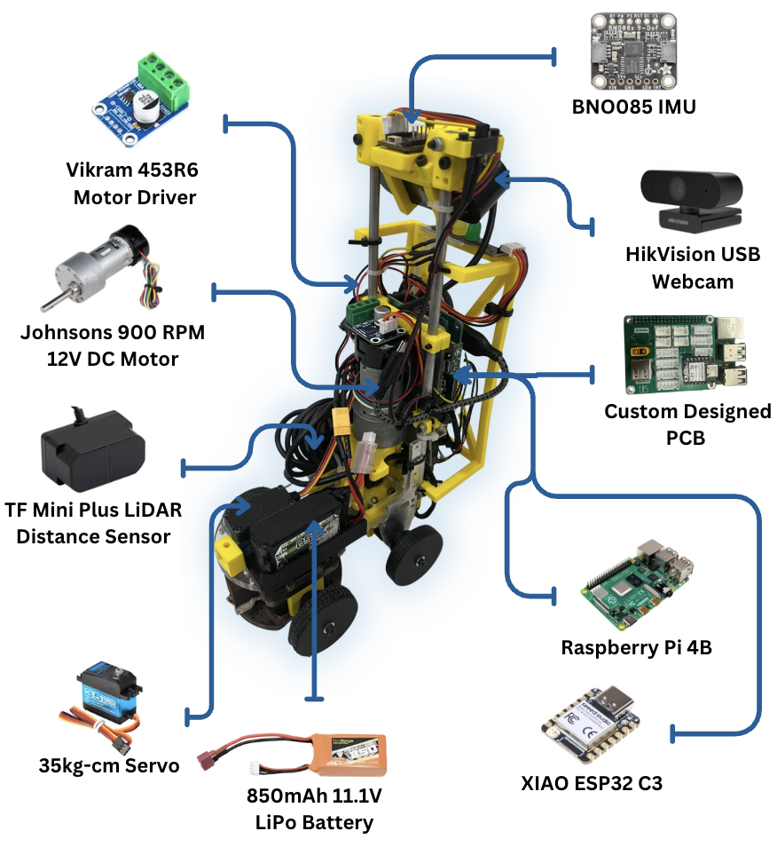</td>
  </tr>
  <tr>
    <td colspan="2" align="center"><b>Labelled Hardware View</b></td>
  </tr>
  <tr>
    <td colspan="2" align="center">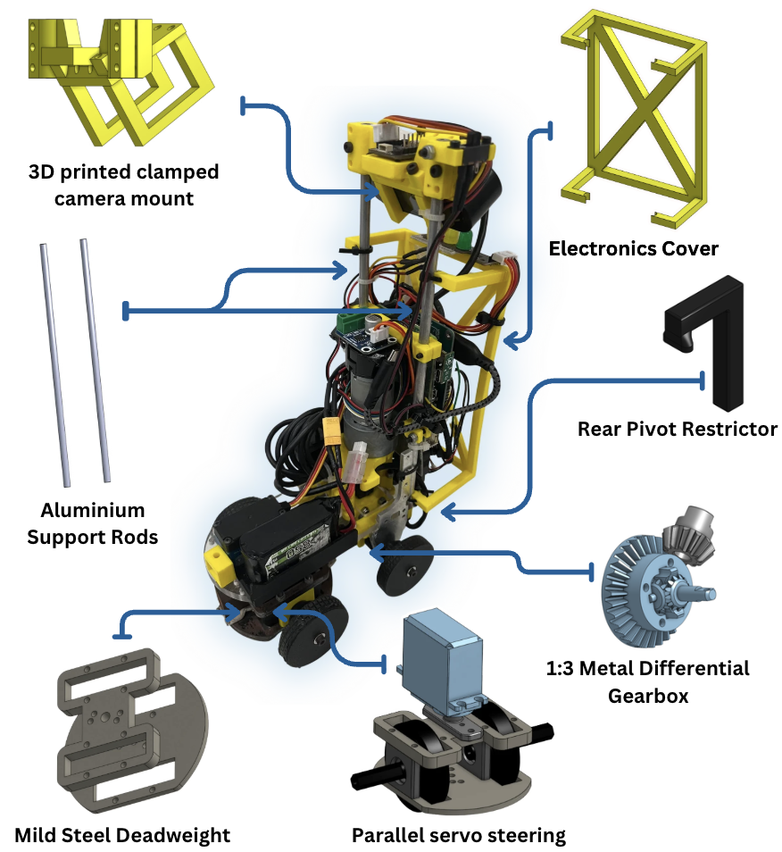</td>
  </tr>
</table>

</div>

### Key Specifications

| Parameter | Value |
|-----------|-------|
| **Dimensions** | 190 × 120 × 300 mm |
| **Weight** | 1.35 kg |
| **Drive Type** | Rear-wheel drive, 12V DC geared motor + external quadrature encoder |
| **Steering** | Servo-actuated parallel steering system |
| **Primary Brain** | Raspberry Pi 4B (4 GB) |
| **Co-processor** | Seeed XIAO ESP32-C3 (IMU + encoder over USB UART) |
| **Vision** | USB Camera + OpenCV HSV pipeline |
| **Heading** | Adafruit BNO085 9-DOF IMU (on XIAO, I2C) |
| **Max Speed (No-Load)** | 1.04 m/s |

### Performance Specifications

| Metric | Value |
|--------|-------|
| **Max no-load speed** | 1.04 m/s |
| **Max operational speed** | 0.83 m/s |
| **Battery capacity** | 850 mAh LiPo |
| **Camera FPS (live loop)** | ~25 FPS |
| **IMU update rate** | 100Hz (BNO085 Euler output) |
| **UART baud rate** | 115200 (XIAO → Pi) |

---

## 🔧 Electronic Systems & Components

### Component List

| Component | Image | Specifications | Role | Source |
|-----------|-------|---------------|------|--------|
| **Raspberry Pi 4 Model B (4GB)** | 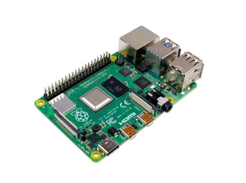 | Quad-core Cortex-A72 @ 1.8GHz, 4 GB LPDDR4, USB 3.0, GPIO 40-pin | Main compute - vision, sensor fusion, PID control via pigpio | [robu.in](https://robu.in/product/raspberry-pi-4-model-b-with-4-gb-ram/) |
| **Seeed XIAO ESP32-C3** | 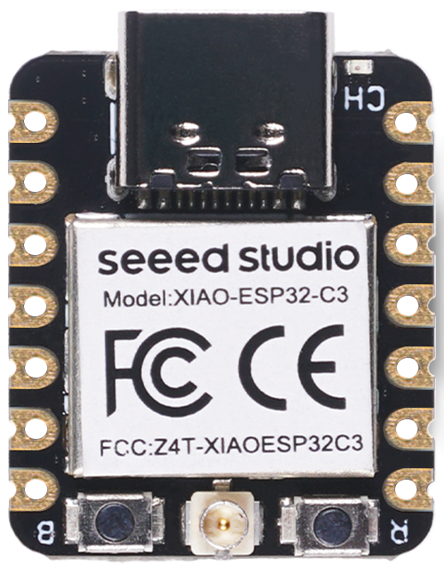 | ESP32-C3 RISC-V @160MHz, 400KB SRAM, USB-C, 3.3V logic, 21×17.5mm | Co-processor - BNO085 IMU + external encoder, streams to Pi at 115200 baud | [robu.in](https://robu.in/product/seeed-studio-xiao-esp32c3/) |
| **Adafruit BNO085 IMU** | 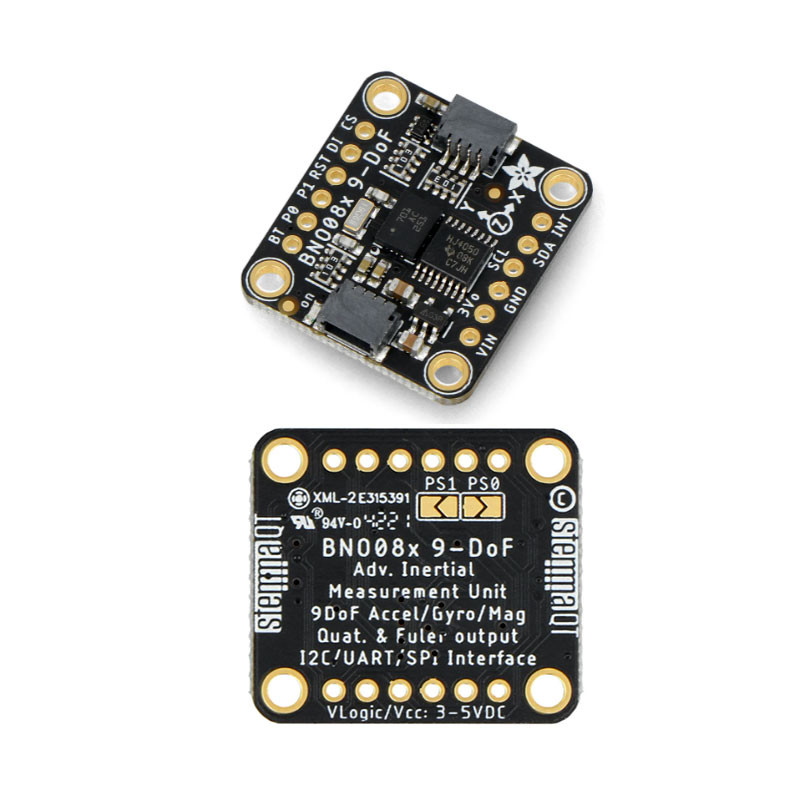 | 9-DOF, ARM Cortex-M0 fusion, Euler @100Hz, I2C | Absolute heading for PID steering - prevents drift across all 3 laps | [evelta.com](https://evelta.com/adafruit-bno085-9-dof-orientation-imu-fusion-breakout/) |
| **HikVision USB Camera** | 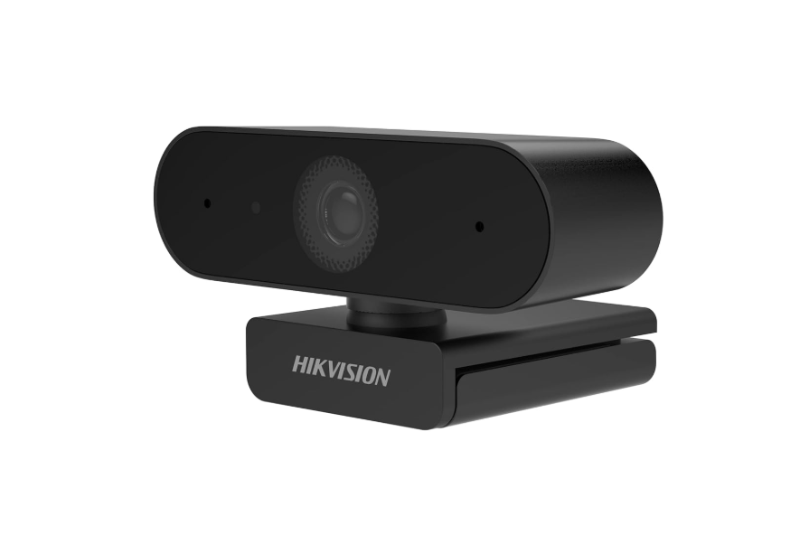 | 2MP, 1080P @ 30fps, ultra-wide, USB 2.0 | HSV pipeline input - detects pillars, parking walls, floor lines, walls | [amazon.in](https://www.amazon.in/HIKVISION-DS-U02-Distortion-Adjustment-Conferencing/dp/B0929FSQ2J) |
| **Johnson 900RPM Grade A** (RKI-1142) | 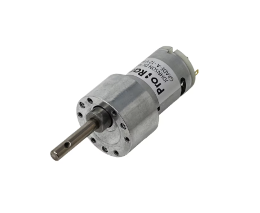 | 12V DC, 900RPM no-load, high-torque grade-A gearbox, no built-in encoder | Rear-wheel drive via Vikram-453R6. External encoder on output shaft | [robokits.co.in](https://robokits.co.in/motors/dc-motor/12v-johnson-motors/johnson-geared-dc-motors/johnson-motor-high-torque-dc-geared-12v-900rpm-grade-a) |
| **7Semi Vikram-453R6** | 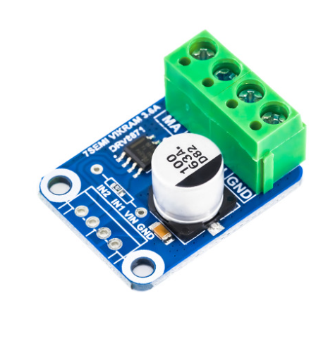 | DRV8871, 6.5–45V, 2A cont / 3.6A peak, IN1/IN2 PWM, thermal protection | Motor driver - IN1=GPIO16, IN2=GPIO20. Auto-recovery on overcurrent | [7semi.com](https://7semi.com/7semi-vikram-453r6-dc-motor-driver-breakout-6-5v-45v-input-3-6a-single-channel/) |
| **Red-Yellow-Green LED** | 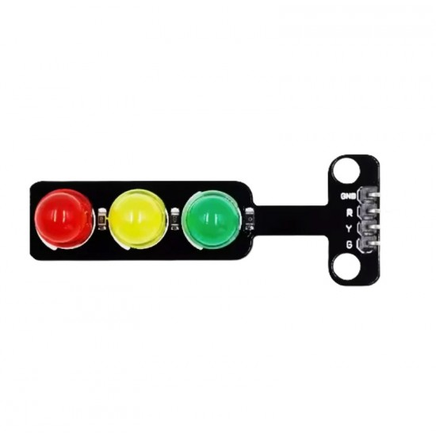 | 5V red, yellow, green LED module with shared VCC, GND | Live update of camera feed - colour flashing is the prominent colour dected | [robu.in](https://robu.in/product/led-traffic-lights-signal-module-digital-signal-output-traffic-light-module/) |
| **Custom PCB** | 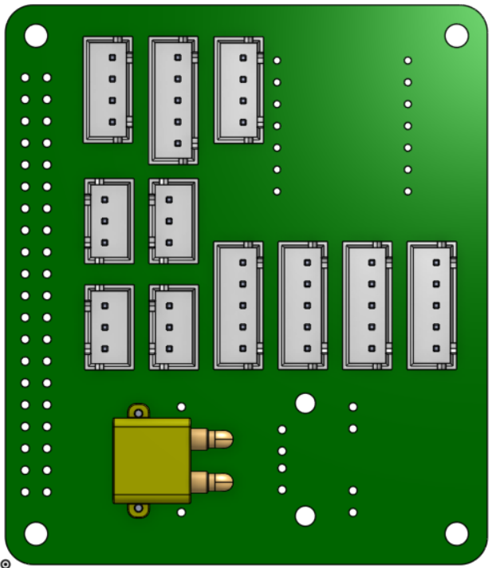 | Custom designed using Altium. Placed on pins of the RasPi, mounts the ESP and DC-DC converter. Contains JST 2.54mm and USB ports | Simplifies wiring | - |
<!-- | **Benewake TFmini Plus LiDAR ×1** | 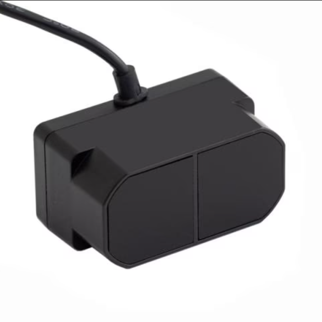 | 0.1–12m, ±5cm accuracy, 3.6° FOV, UART 115200, 5V, IP65, 42×15×16mm | Right-side parking proximity - when `distance < 150mm` parking approach confirmed | [robu.in](https://robu.in/product/tfmini-plus-lidar-distance-sensor-for-drones-uav-uas-robots-12m/) | -->
**Component Selection Philosophy:** We prioritize components that are widely available in India, well-documented, and that we can easily separate by their job - the Pi handles vision and decisions, the XIAO handles encoder and IMU (requiring accuracy and speed), and the Vikram driver is made in India and readily available. Every component was chosen because it solves a specific, tested problem.

### Power Architecture

Our robot uses a **dual-rail power system**. The motor driver (and motor) are supplied directly from the 12V battery, and separated from all other electronics because it causes PWM spikes. The primary electronics (Pi, ESP32, Servo) are on a regulated 5V from a DC-DC converter, and the encoder and IMU are powered from the ESP32's 3.3v rail.

```
[12V 850 mAh LiPo Battery]
       |
       ├── Vikram-453R6 (IN1=GPIO16, IN2=GPIO20) ──> Johnson 900RPM Motor
       |
       └── 5V Buck Converter (on PCB)
                   ├── Raspberry Pi 4b (5V/3A USB-C)
                   ├── Servo UBEC (dedicated ≥5A)
                   └── Seeed XIAO ESP32-C3 (via Pi USB-C)
                           └── [XIAO 3V3 rail] ──> BNO085 IMU (I2C)
                                                   External encoder (GPIO)

```

**Power budget:**

| Component | Voltage | Current | Expected Power |
|-----------|---------|---------|----------------|
| Johnson 900RPM (loaded) | 12V | 800mA running, 2.4A stall | 9.6W (28.8W stall) |
| Raspberry Pi 4B | 5V | 1.2A | 6.0W |
| XIAO ESP32-C3 | 5V | 200mA | 1.0W |
| DS3235 servo | 5V | 1A running, 1.9A stall | 5.0W (9.5W stall) |
| BNO085x IMU | 3.3V | 7.5mA | 0.025W |
| **Regular total** | - | - | **~21.63W** |

**Battery Specifications & Battery Runtime Calculations:**
<div align="center">
  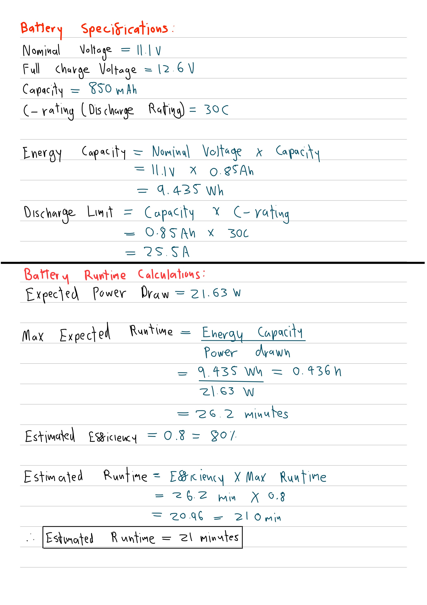
</div>

The calculations above show that with average current consumption, our battery can run for upto 26.2 minutes, but with an estimated 80% efficiency, it can run for around 21 minutes.

Note that in the section titled “Battery Specifications”, multiple specifications related to our battery is given, not just those related to the battery lifetime calculations.

### Wiring Diagram

<div align="center">
  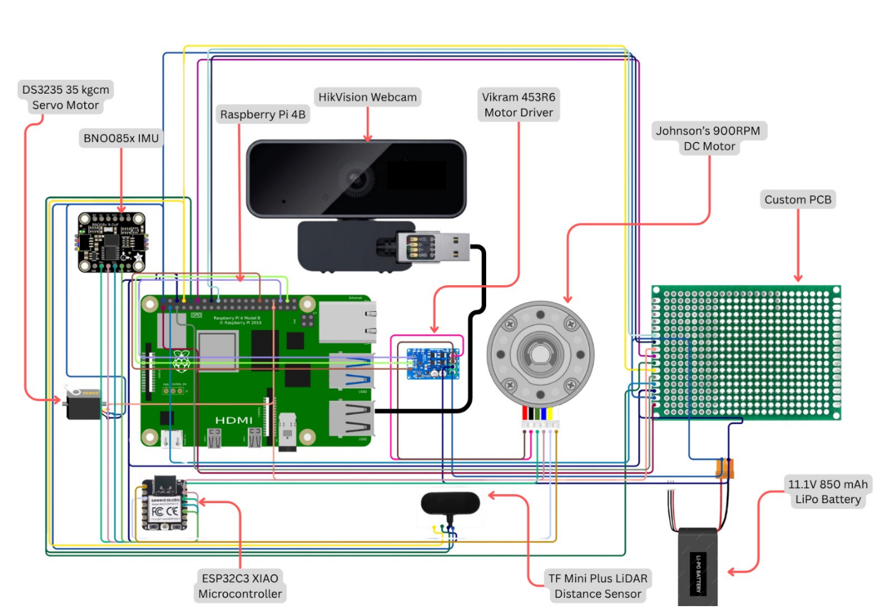
</div>

### GPIO Pin Assignment

| GPIO / Interface | Function | Direction |
|-----------------|----------|-----------|
| GPIO6 | Kill switch input | IN |
| GPIO8 | DS3235 servo PWM | OUT |
| GPIO13 | Red LED | OUT |
| GPIO16 | Vikram IN1 - forward PWM | OUT |
| GPIO19 | XIAO reset | OUT |
| GPIO20 | Vikram IN2 - reverse PWM | OUT |
| GPIO26 | Blue LED | OUT |
| /dev/XIAO_USB | XIAO ESP32-C3 (UART) | IN/OUT |
| /dev/video0 | USB camera | IN |

### Sensor Placement Rationale

**Camera:** Front-facing, slight downward angle. The camera's exposure is fixed at 200 because without this, auto-exposure flicker (1) between light/dark mat sections caused false negatives on every orange line crossing. It runs with an FPS of around 25.

**BNO085 IMU:** Mounted above the camera, as far from the motor and driver as possible (80mm) so that there is no magnetic interference. It is controlled by the XIAO and powered from XIAO 3V3 only.

### Power Management - Engineering Note

During early testing we found the Pi's 3V3 rail was insufficient to power the BNO085 cleanly when the motor was under load. The fix was to power the BNO085 exclusively from the XIAO's own 3V3 regulator, which is isolated from the Pi's rail entirely. This is why the XIAO is powered via USB from the Pi (5V) but the BNO085 never touches the Pi's 3V3 pin.

---

## ⚙️ Mechanical Systems

### Chassis Design

<div align="center">
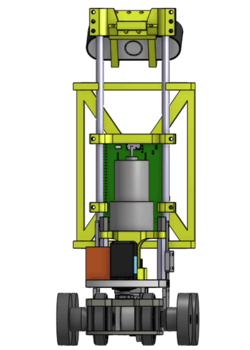
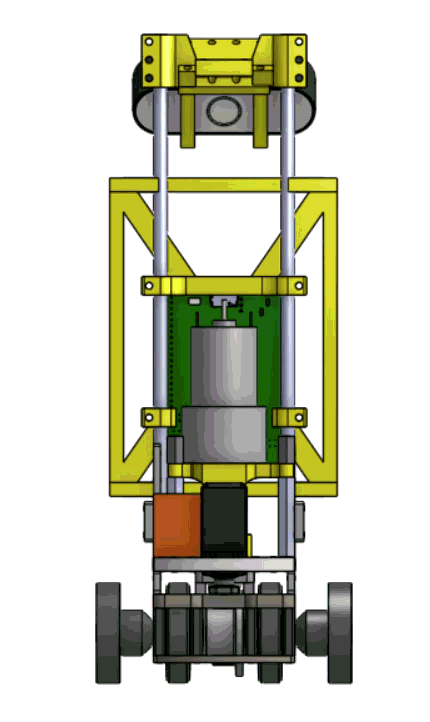
</div>
The chassis is CNC-cut from polycarbonate sheet (not 3D printed). The rear axle is driven by the Johnson 900RPM motor via direct coupling through a differential drive. The front parallel steering is actuated by the DS3235 35kg Servo (directly screwed on).

**Polycarb Plate:**

This is a CAD drawing (with dimensions) of the base polycarbonate chassis, to be CNC-cut. (CAD file is in /models/STL)
<div align="center">
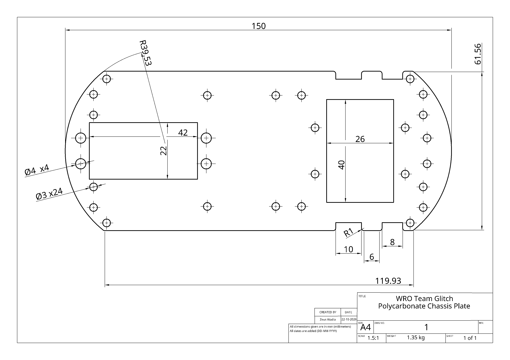
</div>

**Why Parallel Steering?** We first considered using Ackerman geometry to reduce wheel skid and tyre scrub, as well as being more compact. However, this system had too much mechanical play and the steering would jitter during turns and couldn't take sharp turns. Therefore, we decided to use a simpler parallel steering linkage, which helped us make our bot less complex and more consistent by reducing mechanical play..

**Acknowledging Trade-Offs:**
A parallel steering linkage makes the inner wheel skid on tight turns because each wheel follows a different radius. However, using custom designed wheels coated with cat-tongue grip tape helped us minimise tyre deformation. A parallel steering linkage is also heavier and less compact than using Ackerman geometry, but we prioritised consistency over compactness.


### Toppling Prevention and Stability

Our robot design was focused on having a high camera mount and small light chassis. The higher camera mount lets the robot have a greater field of view, which reduces blind spots and lets it detect obstacles from further away. However, having the motor and electonics all placed along the mount at the rear made the robot extremely back- and top-heavy, leading to it falling when it tried to accelerate. 

To fix this, we replaced the 3D-printed servo mounts and connections at the front with mild steel. This added a lot of stability when the robot was at a constant speed, but also increased the mass of the robot by ~450g, making increasing the load on the motor. These are CAD drawings (with dimensions) of the mild steel servo deadweights:
<div align="center">
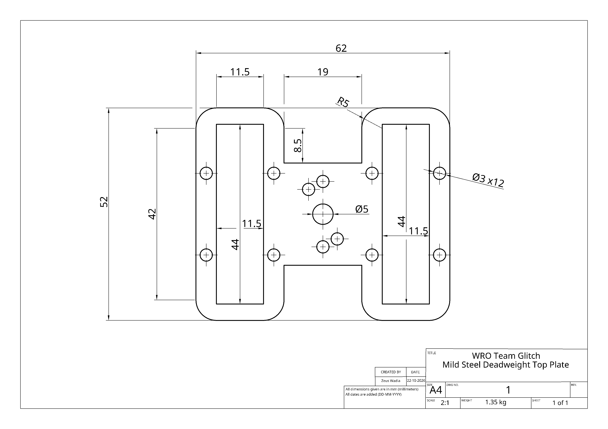
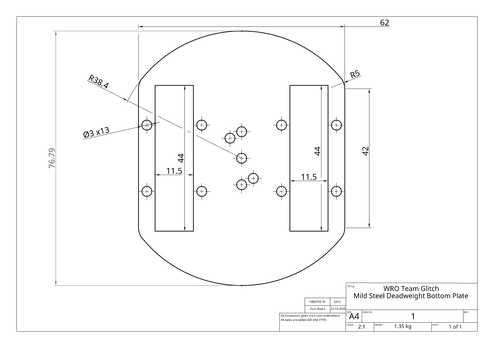
</div>

However, even this had a problem where when the robot had sudden jerks it toppled backwards. We didn't want to add more weight as it would adversely affect the motor, so instead we 3D printed leg at the rear end of the chassis, that ends 5mm above the ground. If the robot tipped back, the leg would keep it upright and let it fall back to normal.

This is the CAD-generated center of mass comparison between the old (no deadweight) and new (deadweight+support) iterations of the robot.

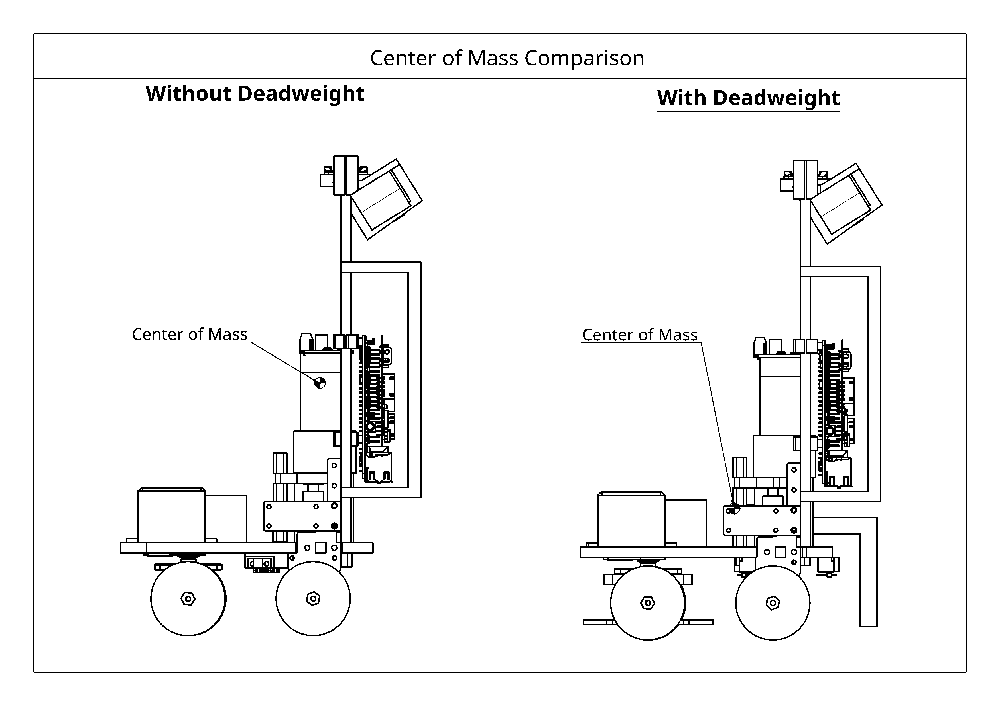

### Drive System

**Motor Selection:**

| Option | Rated Speed | Rated Torque | Rated Current | Verdict |
|---------|-----|-------|---------|---------|
| Cytron IG42E-04K Planetary DC Motor | 1400 RPM | 2.24 kg·cm | 5500 mA | Rated current too high (our motor driver max was 2000 mA) |
| Rhino GB37 1000RPM | 1000 RPM | 0.17 kg·cm | 300 mA | Enough speed but stalled at low PWM and had insufficient torque |
| Johnson 600 RPM | 300 | 3.6 kg·cm | 800 mA | Enough torque but limited top speed |
| **Johnson 900RPM Grade A** | **900 RPM** | **1.2 kg.cm** | **800 mA** | **Current choice - best torque/speed/current balance with external encoder added** |

**Drivetrain no-load speed calculation:**

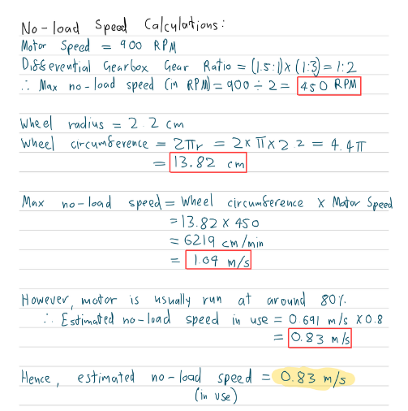

**Increasing Speed After Nationals: Secondary Gearbox:**
At the National Competition, we sent the motor shaft straight into a bevel gear connecting to the differential gearbox at a 39:13 ratio, meaning for every 3 rotations of the motor the wheels would rotate once. However, this was quite slow and for the International competition we wanted to improve our speed. Therefore, we added a second gearbox with a 1:1.5 ratio, effectively changing the output to 2:1. It was a good trade-off, with a much higher speed for a small decrease in torque.
We chose not to change the differential as it was store-bought, and the motor as there weren't any motors in our battery range with higher RPM and similar torque. 

**Torque Calculations**

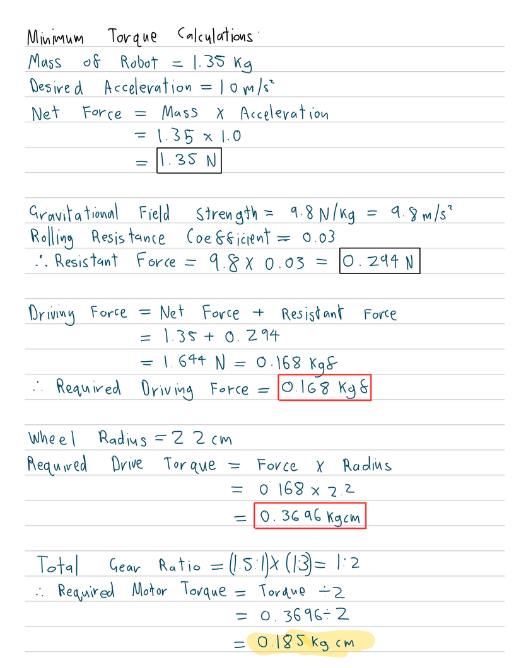


**Motor Driver:** The Vikram-453R6 (DRV8871) replaced the MDD3A after two driver failures - the MDD3A has no overcurrent protection. The DRV8871 adds hardware overcurrent detection, thermal shutdown, and auto-recovery. Its 45W ceiling can easily handle the inductive spikes. The IN1/IN2 PWM interface is pin-compatible with MDD3A so no code changes were needed.

**Reducing Tyre Skid: Differential Gearbox:**
Since while turning, both wheels follow a different turning radius, we decided to use a differential gearbox, which allows the wheels to rotate at different speeds while turning, reducing wheel slippage and improving traction. It uses a ring gear, spider gear, and side gears connected to the wheels, allowing the outer wheel to rotate faster and the inner wheel slower during turns while maintaining a constant motor speed.

### Structural Analysis

| Metric | Value |
|--------|-------|
| Chassis material | 6mm polycarbonate (CNC cut) |
| Motor mount hardware | M3 bolts |
| Servo mount | Press-fit into servo bay with M3 bolts |
| Camera tilt | Fixed 32° downward |

### Iteration History

<div align="center">
  
</div>

**Version 1 - Early Iteration:**
- Arduino Mega main processor
- Pixy2 Camera for vision
- GS2010MG 20kgcm Servo Motor
- TFMini Plus LiDAR (front facing)
- Johnsons Grade B 600RPM motor, MDD3A driver
- 12V DC Coin LED (x2)
- Problem: Parking unreliable - single-pass approach would overshoot. Camera also had a lower FoV. Motor didn't have enough torque. Motor driver failed multiple times due to lack of overcurrent protection. 

**Version 2 - India Nationals:**
- Replaced Arduino Mega & Pixy2 Camera with:
  - **XIAO ESP32-C3** - BNO085 IMU + external encoder over USB UART
  - **HikVision DS-UO2 USB Camera** - Main vision
  - **OpenCV HSV pipeline** - controls the HikVision camera
- Added a custom PCB to minimize risk of loose/tangled wires, mounted directly on the Pi.
- Switched from **Rhino GB37** to **Johnson DC 900RPM Grade A** + external encoder (higher speed, lower torque)
- Switched from **MDD3A** to **Vikram-453R6 Motor Driver** (DRV8871) - overcurrent protection and more compact
- Added `gains.json` which allowed us to change PID gains during a run (test multiple values)

**Version 3 - Internationals:**
- MATLAB calibration code that allows us to record the robot run, extract colour data from it, and calibrate HSV
- Gear ratio change from 3:1 to 2:1, effectively changing output RPM from 300 to 450
- Removed TFMini entirely - all based on camera now
- Working on making a better balance on the robot and reducing weight
- Removed encoder/speed PID entirely, as now the motor had enough torque to run continously

### Potential Future Improvements

- Switch to a motor with a built-in encoder to eliminate the external encoder mount complexity
- Add a rear-facing camera or TFmini for reverse safety during parking
- Replace polycarbonate tray with a custom PCB carrier for better wire management
- Implement automatic `SPEED_SCALE` calibration from the first run's log file

---

## 💻 Software Architecture

The software runs on the Raspberry Pi 4 using Python's multiprocessing module. We are running 3 OS processes concurrently on separate CPU cores, communicating via `multiprocessing.Value` shared memory. This prevents slow camera inference from blocking the time-critical steering loop.

### Process Architecture

```
┌─────────────────────────────────────────────────────┐
│                     Main Process                    │
│          Spawns all child processes, exits          │
└──────┬──────────────┬───────────────────────────────┘
       │              │                    │
┌──────▼──────┐ ┌─────▼─────────┐ ┌────────▼────────┐
│CameraProcess│ │IMUandEncoder  │ │  DriveProcess   │
│  (P)        │ │  (E)          │ │  (S) MAIN LOOP  │
│ OpenCV HSV  │ │ /dev/XIAO     │ │ Reads ALL       │
│ pipeline    │ │ _USB UART     │ │ shared memory   │
│ → red_b     │ │ → head.value  │ │ PID steering    │
│ → green_b   │ │ → counts.val  │ │ Speed PID       │
│ → pink_b    │ │               │ │ State machine   │
│ → wall_*    │ │               │ │ Motor + servo   │
└─────────────┘ └───────────────┘ └─────────────────┘
```

**Why multiprocessing over threading?** Python's GIL prevents threads from running CPU-bound tasks truly in parallel. `multiprocessing` spawns real OS processes - each with its own GIL - so `CameraProcess` (OpenCV) and `IMUandEncoder` (UART reads) run on separate Pi cores simultaneously.

### Shared Variables (cross-process, lock-protected)

| Variable | Type | Written by | Read by | Purpose |
|----------|------|-----------|---------|---------|
| `head` | float | IMUandEncoder | DriveProcess | IMU heading (°) from BNO085 |
| `counts` | int | IMUandEncoder | DriveProcess | Encoder count for odometry + speed PID |
| `red_b` | bool | CameraProcess | DriveProcess | Red pillar visible |
| `green_b` | bool | CameraProcess | DriveProcess | Green pillar visible |
| `pink_b` | bool | CameraProcess | DriveProcess | Magenta parking marker visible |
| `centr_x/y` | float | CameraProcess | DriveProcess | Green pillar centroid |
| `centr_x_red/y_red` | float | CameraProcess | DriveProcess | Red pillar centroid |
| `centr_x_pink/y_pink` | float | CameraProcess | DriveProcess | Pink marker centroid |
| `wall_left/right` | double | CameraProcess | DriveProcess | Inner wall centroid-X |
| `outer_wall_left/right` | double | CameraProcess | DriveProcess | Outer wall centroid-X |
| `close_wall` | double | CameraProcess | DriveProcess | Close wall area - turn/parking |
| `park_wall` | double | CameraProcess | DriveProcess | Parking wall area |
| `last_wall` | double | CameraProcess | DriveProcess | End-wall area - parking trigger + open stop |
| `orange_l / blue_l` | bool | CameraProcess | DriveProcess | Floor line colour - lap direction |
| `switch_state` | bool | DriveProcess | CameraProcess | Kill-switch state |

### XIAO UART Protocol

The XIAO ESP32-C3 firmware streams sensor data to the Pi at 115200 baud:

**Output format (every loop):**
```
<heading_float> <encoder_int>\n
Example: 91.34 2841
```

**Commands accepted from Pi:**

| Command | Effect |
|---------|--------|
| `b"R"` | Software reset - reboots XIAO and reinitialises BNO085 |
| `b"1"` | Zero the encoder count |

### PID Steering Control (`correctAngle`)

```python
error_gyro = heading - setPoint_gyro
if error_gyro > 180:
    error_gyro -= 360           # handle wraparound

pTerm = kp * error_gyro * multiplier   # kp = 0.6
dTerm = kd * ((error_gyro - prevErrorGyro) / dt)  # kd = 0.01
correction = pTerm + dTerm
correction = max(-25, min(25, correction))

servo.setAngle(95 - correction)   # 95° = mechanical centre
```

We use a 'multiplier' term factored into our PID so that we don't have to save multiple sets of values for different aggressiveness. The values we use are: `1.0` = straight-line hold, `1.5` = normal driving, `3.0` = tight parking turns.

### Obstacle Avoidance - Centroid PD

```python
# Target centroid X positions for each colour + state
if obstacle_state == 1: # following the block
    if green_b.value and not close_green.value:
        err = 340-centr_x # take block to little right of center
    elif red_b.value and not close_red.value:
        err = 300-centr_x # take block to a little left of center
    elif close_green.value or close_red.value: # block is close (140px on y-axis)
        obstacle_state = 2
elif obstacle_state == 2: # turning
    if green_b.value:
        err = 520 - centr_x # take block to right side of the camera feed
    elif red_b.value:
        err = 120 - centr_x # take block to left side of the camera feed
    elif time.time()-block_time > 0.8: # block has been passed
        obstacle_state = 1
servo_angle = err * kp_s + ((err - prev_err) / dt_main) * kd_s # PID
servo_angle = max(-30, min(30, servo_angle)) # clamp servo angle
servo.setAngle(95 - servo_angle) # 95 is mechanical center
```


This is a simplified code of our obstacle avoidance. State 2 lasts 0.8s then resets to state 1, or resets early when you can see pink or walls very near. When no block is visible and one inner wall is detected, a fixed ±15 err nudge centers the robot. When outer walls are visible without blocks, heading is corrected by `heading_angle ± 5°`.

<div align = "center"> 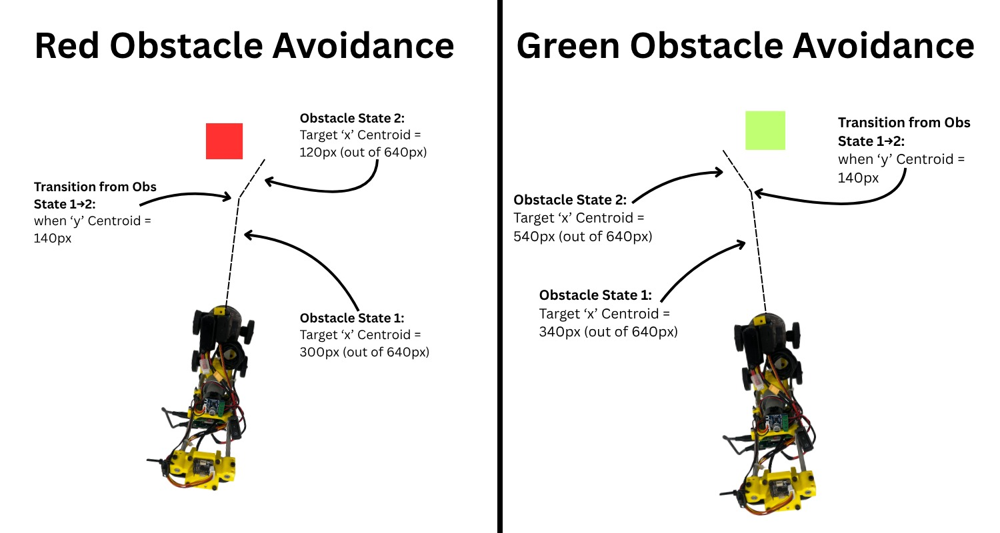 </div>
2-stage avoidance diagram

### Speed PID (`correctSpeed`)

Positional PID - output recomputed fresh each call, not accumulated:

```python
actual_cps = raw_delta / dt # encoder counts per second
target_cps = target_power_pct * SPEED_SCALE / 100.0
error = target_cps - actual_cps

total_error_speed += error * dt
total_error_speed = max(-500, min(500, total_error_speed)) # anti-windup

correction = kp_v * error + ki_v * total_error_speed + kd_v * (error - prev_error) / dt
duty = target_power_pct + correction   # baseline + correction - NOT accumulated
duty = max(0.0, min(100.0, duty))
```

Auto-resets on direction flip. `SPEED_SCALE` must be calibrated from run logs - the default in `gains.json` is `0.0` as a reminder.

### Vision Pipeline

`CameraProcess` runs either `vision_pipeline_new.py` (obstacle) or `vision_pipeline_3.py` (open). Both of them are only based on OpenCV, with no ML.

**Pipeline steps:**
1. Capture frame via `cap.read()` - buffer size = 1 so always latest frame
2. Resize to `FRAME_WIDTH × FRAME_HEIGHT`
3. Convert to HSV (and LAB if `USE_LAB = True`)
4. Threshold per colour class per zone
5. Find contours, filter by area minimum
6. For each zone: pick largest block by area (or lowest by centroid-Y = closest)
7. Write centroid/area/flag to shared memory

**Camera settings:**
```python
cap.set(cv2.CAP_PROP_EXPOSURE, -6)   # fixed - no flicker on mat transitions
cap.set(cv2.CAP_PROP_BUFFERSIZE, 1)  # always newest frame - critical at 25fps
```

| Colour | Zones | Role |
|--------|-------|------|
| Red | `main`, `close` | Red pillar |
| Green | `main`, `close` | Green pillar |
| Magenta | `main`, `close` | Parking lot boundary |
| Orange | `line`, `line_2` | CW floor line |
| Blue | `line`, `line_2` | CCW floor line |
| Black | `wall_inner_left/right`, `wall_left/right`, `close_black`, `parking_wall`, `last_wall`, `last_wall_2` | Walls + parking zones |

When red and green are both visible, the closer one (larger centroid-Y) takes priority.

---

## 🧭 Open Challenge - Strategy & Logic

For this, we run `OPEN_NATIONALS_FINAL.py` with `vision_pipeline_3.py`. We don't use any speed PID, and generally run it with motor power 85%.

### State Machine

```
INITIALIZE
    │  Wait for any sensor input → init = True, servo to 65° and back (init seq)
    ▼
DIRECTION DETECTION (first trigger only)
    |  Blindly move forward (IMU for correction) until line detected
    │  blue_l  → blue_flag = True (CCW)
    │  orange_l → orange_flag = True (CW)
    ▼
DRIVING LOOP - counter < 12

    Steering priority:
    1. Both outer walls visible:
         err = 320 − ((left_offset + right_offset) / 2)
         servo.setAngle(90 + servo_angle)
    2. Left wall only:  err = outer_wall_left / 2
    3. Right wall only: err = −(640 − outer_wall_right) / 2
    4. Inner wall (counter > 0):
         left only  → correctAngle(heading + 10, 1)
         right only → correctAngle(heading − 10, 1)
    5. Fallback: correctAngle(heading_angle, head, 1)

    Motor: 85% target, smoothed ramp (power×0.01 + prev×0.99)

    TURN TRIGGER
    │  orange_l AND orange_flag AND not trigger: trigger = True
    │  blue_l AND blue_flag AND not trigger: trigger = True
    │  Trigger resets after 2s timeout
    ▼
    TURN EXECUTION (counter_flag=False AND trigger)
    │  Wait for corr < 5° or close_wall / open-side TOF breaks early
    │  → counter++
    │  → heading_angle = update_heading(counter, ...)
    │  → counter_flag = True
    ▼
STOP - counter == 12
    All 4 conditions simultaneously:
    • NOT trigger
    • time since last trigger > 3.5s
    • get_closest_setpoint(head) == heading_angle
    • last_wall.value > 0
    → runMotor(0, 1) → sys.exit(0)
```

### Open Challenge Pseudocode

```
INITIALIZE sensors, servo to 65°
WHILE direction unknown:
    DETECT orange_l or blue_l floor line
    SET direction = CW (orange) or CCW (blue)

WHILE counter < 12:
    READ outer wall centroids from camera
    COMPUTE steering error from wall centroids
    APPLY servo correction (PD on pixel error)
    DETECT floor line colour trigger
    IF trigger: counter++, update heading setpoint

CHECK stop conditions (all 4 must be true)
STOP motor
```

---

## 🚧 Obstacle Challenge - Strategy & Logic

### Full State Machine

```
STARTUP
    CameraProcess (P) - OpenCV HSV pipeline
    IMUandEncoder (E) - XIAO UART: heading + encoder counts
    DriveProcess (S)  - main loop

DIRECTION + PARKING SIDE DETECTION
    outer_wall_left only → orange_flag (CW, parking right)
    outer_wall_right only → blue_flag (CCW, parking left)

STARTUP MANEUVER (inParkingatStart)
    orange: correctAngle(heading + 60, multiplier=3)
    blue:   correctAngle(heading − 70, multiplier=3)
    Drive forward (ramp: duty×0.001 + prev×0.999) until corr < 2°

DRIVING LOOP - counter < 12

    Block visible:
        Green state1: err = 340 − centr_x
        Green state2: err = 520 − centr_x  (blue+wall: 320/470)
        Red state1:   err = 300 − centr_x_red
        Red state2:   err = 120 − centr_x_red  (orange+wall: 320/170)
        None + one inner wall: err = ±15 nudge
        None + no block: correctAngle(heading ± 5°, 1.5)
        Pink + continue_parking: err = 540−pink_x (right) / 125−pink_x (left)

    Centroid PD: servo_angle = err×kp_s + (Δerr/dt)×kd_s, clamped ±30°
    obstacle_state 1→2: centr_y > 100 (block close)
    obstacle_state 2→1: after 0.08s, or pink/close_wall triggers early

    Turn trigger: orange_l (CW) or blue_l (CCW)
        → counter++, heading_angle updated
        → trigger resets after 2s

    Motor: 90% base, 75% when block visible

LAP FINISH - counter == 12
    Drive to heading setpoint (orange:270°, blue:−270°), time > 1.7s
    Drive until close_wall > 0 (max 0.5s)
    Reverse 3s with correctReverseAngle
    Compute target encoder:
        orange: counts + 10000
        blue:  counts + 8500
    Drive forward until counts ≥ target → stop 2s → lap_finish = True

PRE-PARKING
    orange: heading += 90, blue: heading −= 90
    Reverse until corr < 5°, reverse 1s, reverse while park_wall > 3100
    Forward until park_wall > 3100
    heading ± 95°, reverse until corr < 5° → continue_parking = True

CONTINUE PARKING (parking approach)
    Drive forward at 40%
    Steer: pink visible → follow pink centroid
           else → correctAngle(heading, 1)
    Trigger: last_wall > 1570 AND |heading_err| < 15° AND not pink
           → parking_flag = True

MAIN PARKING
    STATE 1: Reverse until not pink_b
             If last_wall < 1500: forward (counts + 700)
             → STATE 2

    STATE 2: heading −= 90 (right) or += 90 (left)
             Reverse until corr < 5°
             Reverse until pink_b visible
             → STATE 4

    STATE 4: count_thresh = 400 (pink_x ≥ 320) or 600 (pink_x < 320)
             heading_thresh = 60 or 80; PID_thresh = 1.5 or 3.0
             Forward count_thresh counts with correctAngle(heading + heading_thresh)
             Reverse until corr < 8°
             Forward until centr_y_pink > 235  ← visual terminal condition
             Motor stop, servo 95°, sys.exit(0)
```

### Parking Strategy - Why Multi-Stage?

A simple forward drive into the slot fails because the robot always arrives at a slight angle from the final turn. Our 4-state sequence solves this:

- **STATE 1:** Backs out until the pink boundary disappears (exits the approach angle), then optionally drives forward into position
- **STATE 2:** Rotates 90° and reverses until the pink boundary is visible again (robot physically inside the slot)
- **STATE 3:** Forward with heading bias, then straighten, then inch forward until `centr_y_pink > 235` - the pink border filling the camera frame is the terminal condition, independent of encoder count or time

**Why `centr_y_pink > 235`?** When the pink boundary fills the bottom of the camera frame, the robot is fully inside the lot by visual confirmation. This is more reliable than an encoder count, which can vary with wheel slip and battery voltage.

### Obstacle Challenge Pseudocode

```
INITIALIZE sensors, detect direction from side distances
EXECUTE startup maneuver (steer away from wall, straighten)

WHILE counter < 12:
    READ camera: red_b, green_b, centr_x, centr_x_red
    COMPUTE err from block centroid or wall nudge
    APPLY centroid PD to servo
    DETECT floor line trigger → counter++
    IF counter == 12: execute lap-finish routine

COMPUTE parking position from encoder counts
STOP → lap_finish = True

EXECUTE pre-parking maneuver (align heading to slot)
DRIVE forward, follow pink or heading
WAIT for parking_flag (last_wall + heading aligned)

EXECUTE STATE 1 → STATE 2 → STATE 4 parking sequence
CONFIRM by centr_y_pink > 235
STOP
```

---
## 🏆 Our Experience at India Nationals 
### Overview
At the India National Championship in Hyderabad in August, we placed 1st out of the 31 teams present. We scored 116 out of the available 122 points, with 30 in Open Challenge, 62 in Obstacle Challenge, and 24 in documentation. All 4 of our robot rounds scored full points. 

### Challenges and Solutions
**1. Lighting and Camera Detection:**
Prior to nationals, we had planned and calibrated the robot to work in pure and neutral white lighting. However, at the National Championship, there were yellow and white spotlights, which were very different from the light colour and intensity we had worked with. One of the largest problems stemming from this was that at one corner, the robot couldn't detect the orange line because of the glare, instead reading it as 255,255,255 (white).

We solved this by adding a fallback condition - if after a certain time period (4.3s) on each straight lane an orange line wasn't detected, the robot would turn back and align with the side wall. Then it would update its counter (marking the turn as done) and continue as usual. This came into use in both the final obstacle runs - two turns on each relied on the fallback. 

**2. Magenta Blocks:**
In the national championship, while teams were calibrating their robots to the conditions of the competition, many teams (including ourselves) struggled with calibrating as per the magenta wood blocks (parking blocks) provided, as they were a bright pink colour, which was very close to red on the HSV colour scale. This was a problem for many teams, as lots of them used HSV colour detection for block detection.

Multiple teams raised this issue to the judges, and the judges were searching for a suitable colour for the magenta block, so we decided to give them our block, for a sample for which shade of magenta teams would be able to differentiate from red. This colour was later implemented, as all teams agreed with the shade of magenta. Helping the judges find a more suitable shade of magenta not only made life easier for them, but also helped other teams gain a better chance of successfully completing a parking in the obstacle challenge.

**You can view our final Nationals obstacle challenge run [here](https://youtu.be/jeS_SY3YWWI), and open challenge run [here](https://youtu.be/IkwKVlRDRw8).**

## 🔄 Engineering Decisions & Iterations

### Decision 1: Motor Driver Upgrade - MDD3A → Vikram-453R6

We originally used a MDD3A single-channel motor driver. However, this was extremely bulky and had had no overcurrent protection - a wall collision at speed passes full current straight through. Because of this, we switched to the Vikram-453R6 (with DRV8871 chip), which gives the robot hardware overcurrent detection, thermal shutdown, and auto-recovery. It is also pin-compatible with the MDD3A, so we didn't need to make any major changes.

### Decision 2: Multiprocessing vs. Single-Threaded

Our original single-process code led to a loop time of around 15ms, which was much more than the robot could handle. This led to the robot (at 90% speed) travelling around 1.5cm without any sensor input every loop, and the camera giving inputs at only 5fps. Therefore, we decided to use multiprocessing. Raspberry Pi 4B has 4 cores, allowing us to run multiple processes at the same time. We are currently using 3 cores - 1 each for vision, drive, and ESP input (Encoder & IMU). This cut the loop time to around 1/4 of what it was earlier, as each process is running in parallel

### Decision 3: Centroid PD vs. Dead-Reckoning for Pillar Avoidance

Originally, we used an (x, y) position estimate through the encoder & IMU values (calculated using trignometry). However, by the third lap there would be around 30 degrees of accumulated drift. In our current robot, avoidance is driven directly by the pillar's pixel centroid, so we don't have to use positional state. Thie led to no drift, and the target setpoints could be be tuned from video review in minutes instead of hours of encoder calibration.

### Decision 4: Parking Visual Condition

Earlier, our parking versions used encoder counts and timeouts as terminal conditions. However, both were unreliable - encoder counts vary with wheel slip and the differential gearbox, and timeouts don't confirm the robot is actually inside. The `centr_y_pink > 235` threshold is a direct visual confirmation from the camera, as when the pink boundary fills the bottom of frame, the robot is fully inside. This means we don't need any encoder or timer, and it is more accurate.

### Decision 5: Arduino Mega vs Raspberry Pi 4B

Originally, we used Arduino Mega as our primary processor for the robot. However, this only had a single core (slower processing), and much poorer hardware. In addition, it was not easily compatible with OpenCV, which meant it was difficult to have complex camera pipelines. To solve this, we chose to use a Raspberry Pi 4B, which had 4 cores. This allows us to run our 3 processes simultaneously while recording the run on the 4th in the background. It also had a better RAM and clock speed, and could process images faster. In addition, it had USB ports allowing us to connect easily to cameras.

### Potential Future Improvements

- Motor with built-in encoder to simplify hardware
- Auto `SPEED_SCALE` calibration from first run log
- Rear camera or TFmini for reverse safety
- Custom carrier PCB to clean up wiring
- Online PID gain scheduling based on lap time (encoder data already available)

---

## 📹 Performance Videos

### Open Challenge (Image Below Serves as HyperLink):

[](https://www.youtube.com/watch?v=8WccRAMPBGA)

### Obstacle Challenge (Image Below Serves as HyperLink):

[](https://www.youtube.com/watch?v=rnG7ssZLk40)

---

## 🌐 GitHub Utilization

We use GitHub as our central platform for version control, documentation, and public transparency. Our workflow: develop locally, commit at meaningful milestones (completed state machine, fixed parking detection, validated motor driver swap), and update documentation alongside code so the repo always reflects the actual robot.

**Key development milestones:**
- First working chassis + wiring (Version 1)
- HSV pipeline (Version 2)
- Parking state machine
- Multiprocessing architecture finalized
- Speed PID implementation and calibration
- Nationals-ready documentation pass
- Post-nationals improvements
- TFMini removed, all camera-based
- Gear ratio changed

**Commit philosophy:** Each commit represents a tested, working state of the robot. We don't commit broken intermediate states - every push to `main` is something the robot could actually run in competition.

**Documentation standards:**
- ✅ Every hardware change reflected in README 
- ✅ Every code change explained in comments, not just committed
- ✅ Run logs included in `/logs/` for traceability
- ✅ Wiring diagram updated whenever hardware changes

---

## 📜 License

This project is open source. Other teams are encouraged to read, learn from, and build on our documentation and code. The modular architecture and detailed decision rationale are intentionally written to make replication straightforward.

If you build on our work, please keep it open source and credit Team Glitch, WRO 2026.

---

## 🛠️ How to Build & Deploy

### Step 1 - Chassis

Files in `models/`:

```
models/
├── CAD_drawings/                                    # For reference
│   ├── center_of_mass_comparison_drawing.png    
│   ├── mild_steel_dw_bottom_drawing.png          
│   ├── mild_steel_dw_top_drawing.png             
│   ├── poly_plate_drawing.png          
├── DXF/                                             # For laser & CNC cutting
│   ├── 3mm mild steel deadweight lower.dxf          # 3mm Mild Steel
│   ├── 3mm mild steel deadweight upper.dxf          # 3mm Mild Steel
│   ├── 6mm polycarbonate chassis.dxf                # 6mm Polycarbonate
├── STEP/                                      
│   ├── WRO_Glitch_Final_CAD.STEP                    # Full assembly
│   ├── chassis body shaft_ AL 2pc.STEP              # Vertical aluminium shafts
│   ├── chassis body_6mm poly_1pc.STEP               # Polycarbonate chassis
│   ├── poly_6mm_1pc_front axel support.STEP         # Front axel support
│   ├── side bearing mount_ 3mm AL_ 2pc.STEP         # Side bearing mount
└── STL/                                             # For 3D printing        
    ├── Electronics cover.STL
    ├── Front wheel.STL
    ├── Gearbox 2 large gear (on motor).STL
    ├── Gearbox 2 small gear - (on rear axle).STL
    ├── Motor mount.STL
    ├── Rear pivot restrictor.STL
    ├── back Gear Mount.STL
    ├── back rpi mount.STL
    ├── back wheel.STL
    ├── dc motor coupling.STL
    ├── dc motor mount.STL
    ├── front bearing_6_12_holder.STL
    ├── new front wheel.STL
    ├── side bearing plate mount.STL
    ├── side mount tf mini mount.STL
    └── top camera mount.STL
                            


```

Chassis and deadweights are laser/CNC-cut, not printed. Print settings: PETG, 0.2mm layer, 40% gyroid, 4 perimeters. Supports for camera mount and mast base only.

### Step 2 - Assembly

1. Cut chassis (6mm poly).
2. Mount Johnson 900RPM motor. Mount external encoder on output shaft, route cable to XIAO.
3. Install DS3235 servo + Parallel steering linkage. Inner wheel must turn sharper than outer at full lock.
4. Mount sensor mast at front-centre.
5. Mount camera (`new camera mount.STL`) - fixed 10° tilt, no adjustment.
6. Mount RasPi and PCB. Install XIAO, Vikram-453R6.

### Step 3 - Wiring

See `schemes/wiring-diagrams/wiring_diagram.png`. Critical rules:
- BNO085 on XIAO 3V3 only - never Pi 3V3
- Vikram VM = 12V direct from LiPo - never through the 5V buck
- Motor and encoder wires on opposite chassis sides

### Step 4 - Flash XIAO

1. Arduino IDE ≥2.0, board URL: `https://files.seeedstudio.com/arduino/package_seeeduino_boards_index.json`
2. Install: `Adafruit BNO08x`, `Adafruit Unified Sensor`
3. Open `src/ESP32/esp_final.ino`, select **XIAO ESP32C3**, upload.

### Step 5 - Raspberry Pi Setup

Enable UART in `/boot/firmware/config.txt`:
```
dtoverlay=uart2
```

```bash
sudo apt update && sudo apt install -y python3-pip pigpio python3-pigpio ffmpeg i2c-tools
pip3 install opencv-python pyserial RPi.GPIO numpy
```

**Test All Components:**

Use the test scripts in `/src/` (test scripts are labelled in the /src README) to test all the components. Wire them according to our diagram or with your own GPIO pin choices.

### Step 6 - Configure Gains

These are our gains values. They would vary with floor type and wheel grip, so you might have to re-tune them.

```json
{
  "kp": 0.55, "kd": 0.0025, "ki": 0,
  "kp_s": 0.05, "kd_s": 0.0000,
  "kp_o": 1.5, "kd_o": 0.5,
  "kp_v": 0.008, "ki_v": 0.0, "kd_v": 0.00,
  "SPEED_SCALE": 7343.37
}
```

Set `SPEED_SCALE` to 0 until you calibrate it from run logs. File hot-reloads every 0.5s, no restart needed.

### Step 7 - Run

```bash
sudo python3 obstacle_nationals_final.py    # Obstacle Challenge
sudo python3 open_nationals_final.py # Open Challenge
```

Logs: `/home/pi/wro_logs/logs/`. Kill switch: GPIO6.

### Code File Structure

```
WRO_2026/
├── src/
│   ├── obstacle_nationals_final.py# Nationals Obstacle - 3-process
│   ├── obstacle_nov.py            # New faster obstacle code without speed PID
│   ├── open_nationals_final.py    # Open - 3-process
│   ├── vision_pipeline_new.py     # HSV pipeline - obstacle
│   ├── vision_pipeline_3.py       # HSV pipeline - open
│   ├── TFmini.py                  # TFmini Plus UART reader
│   ├── Encoder.py                 # Dead-reckoning (open challenge)
│   ├── Servo.py                   # Servo abstraction (pigpio)
│   ├── gains.json                 # Hot-reloadable PID gains
│   ├── esp_final.ino              # ESP32 IMU/encoder reader + communication to Pi
│   ├── OpenCV/                    
│   │   ├── HSVCalibrateNew.py     # New faster HSV calibration

```

## GitHub Commit Dates
This table shows the dates of the main commits we have made to the GitHub, and how far they were from the competition.

|Commit No.|Date|Time before Nationals|Time before Internationals|
|-|-|-|-|
|1|June 18 2026|69 days|173 days|
|2|July 20 2026|37 days|141 days|
|3|Aug 12 2026|14 days|118 days|
|4|Oct 7 2026|   ---   |62 days|
|5|Nov 13 2026|   ---   |29 days|

**Team Glitch - WRO 2026 Future Engineers - International Finals**

*Documentation last updated: November 2026*
